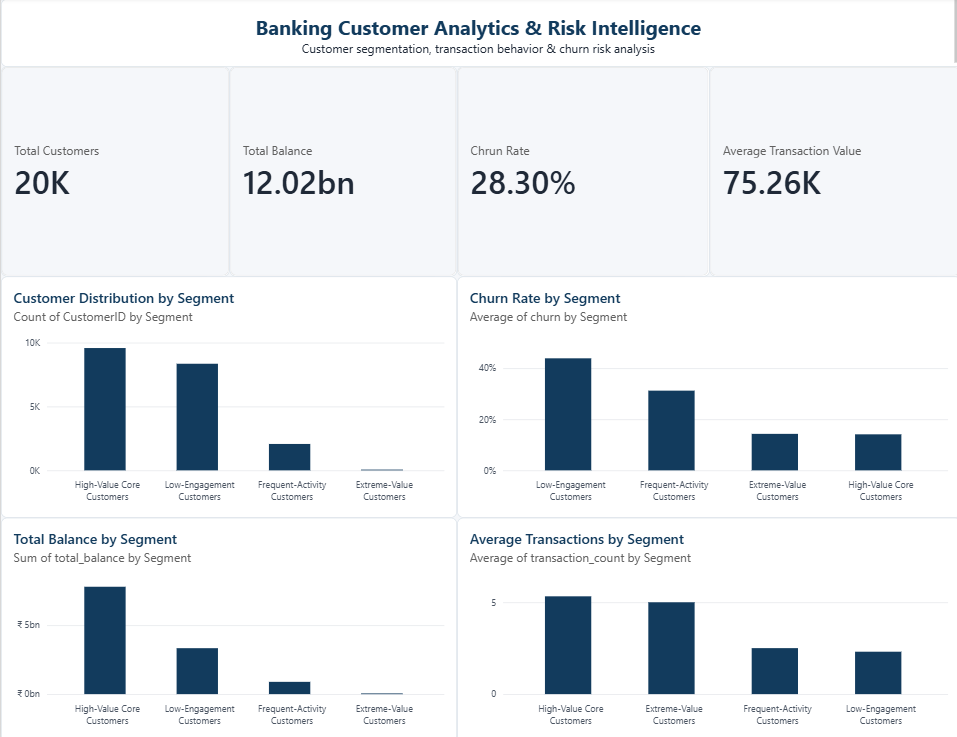

# Banking Customer Analytics & Risk Intelligence Platform

An end-to-end banking analytics project that combines data cleaning, SQL analysis,
customer-level feature engineering, machine learning, customer segmentation, and
Power BI business intelligence to identify customer behavior and churn-risk patterns.

---

## 📊 Power BI Dashboard



The dashboard provides an executive-level view of:

- Customer distribution across behavioral segments
- Observed churn rate by customer segment
- Total balance held by each segment
- Average transaction activity
- Overall customer, balance, churn, and transaction KPIs

---

## 🎯 Business Problem

Banks need to understand customer behavior, identify customers showing signs of
inactivity, and prioritize retention efforts.

This project analyzes customer, account, and transaction data to answer questions such as:

- Which customer segments are most at risk of inactivity?
- Which segments hold the most customer balance?
- Which customer groups are highly active?
- Where should retention efforts be prioritized?
- How can historical customer behavior be used to identify future inactivity?

---

## 🔄 Project Pipeline

```text
Raw Banking Data
       ↓
Data Cleaning & Quality Checks
       ↓
SQL Analysis & Exploratory Analysis
       ↓
Customer-Level Feature Engineering
       ↓
Leakage-Safe Churn Modeling
       ↓
Model Evaluation
       ↓
K-Means Customer Segmentation
       ↓
Risk & Value Analysis
       ↓
Power BI Dashboard
```

---

## 📈 Key Insights & Segmentation Summary

| Segment | Customer Count | Share (%) | Avg Balance | Total Balance | Churn Rate | Balance at Risk | Retention Strategy |
| :--- | :---: | :---: | :---: | :---: | :---: | :---: | :---: |
| **Low-Engagement Customers** | 8,348 | 41.74% | ₹399,367 | ₹3.33 Bn | **43.87%** | **₹1.46 Bn** | 🔥 High Priority Retention & Reactivation |
| **High-Value Core Customers** | 9,578 | 47.89% | ₹813,687 | ₹7.79 Bn | 14.11% | ₹1.10 Bn | 🛡️ Relationship Care & Value Protection |
| **Frequent-Activity Customers**| 2,067 | 10.34% | ₹430,345 | ₹889.5 Mn | 31.20% | ₹277.6 Mn | ⚡ Engagement Nurturing & Cross-Sell |
| **Extreme-Value Customers** | 7 | 0.03% | ₹793,074 | ₹5.55 Mn | 14.29% | ₹793 K | 💎 Personalized Wealth Management |

---

## 🤖 Machine Learning Model Performance

We evaluated multiple classification models for churn and inactivity risk prediction:

| Model | Accuracy | Precision | Recall | F1-Score | ROC-AUC |
| :--- | :---: | :---: | :---: | :---: | :---: |
| **Decision Tree** | **99.75%** | **100.0%** | **99.12%** | **0.9956** | **0.9971** |
| **Random Forest** | 99.68% | 100.0% | 98.85% | 0.9942 | 0.9963 |
| **Logistic Regression** | 99.15% | 98.07% | 98.94% | 0.9850 | 0.9911 |

---

## 📁 Repository Structure

```text
banking-analytics/
├── dashboard/
│   ├── dashboard_preview.png            # Power BI dashboard preview image
│   └── banking_analytics_dashboard.pbix # Power BI report file
├── data/
│   ├── raw/                             # Raw accounts, customers, transactions datasets
│   ├── cleaned/                         # Cleaned datasets, engineered features, model evaluations
│   ├── outputs/                         # Segmentation tables, segment risk, and Power BI master CSV
│   └── banking.db                       # SQLite relational database
├── notebooks/
│   └── 01_data_exploration.ipynb        # End-to-end EDA, ML modeling, clustering & analysis notebook
├── sql/
│   └── analysis.sql                     # SQL exploratory queries & business KPI scripts
├── visualizations/                      # Exported charts & data distribution plots
├── requirements.txt                     # Python dependencies
└── README.md                            # Project documentation
```

---

## 🚀 Getting Started

### 1. Prerequisites
- Python 3.9+
- Power BI Desktop (to view/edit the `.pbix` dashboard)
- Git

### 2. Installation
```bash
# Clone the repository
git clone <YOUR_GITHUB_REPO_URL>
cd banking-analytics

# Create and activate virtual environment
python -m venv .venv
source .venv/bin/activate  # On Windows: .venv\Scripts\activate

# Install dependencies
pip install -r requirements.txt
```

### 3. Running the Project
- **Jupyter Notebook**: Launch Jupyter and open `notebooks/01_data_exploration.ipynb` for full data exploration, modeling, and clustering.
- **SQL Analysis**: Run queries in `sql/analysis.sql` with SQLite or any SQL client connected to `data/banking.db`.
- **Power BI Dashboard**: Open `dashboard/banking_analytics_dashboard.pbix` in Power BI Desktop to interact with the executive dashboard.

---

## 🛠️ Tech Stack
- **Languages & Analysis**: Python, SQL
- **Libraries**: Pandas, NumPy, Scikit-Learn, Matplotlib, Seaborn
- **Database**: SQLite
- **Machine Learning**: Logistic Regression, Random Forest, Decision Tree, K-Means Clustering
- **BI & Visualization**: Microsoft Power BI Desktop
